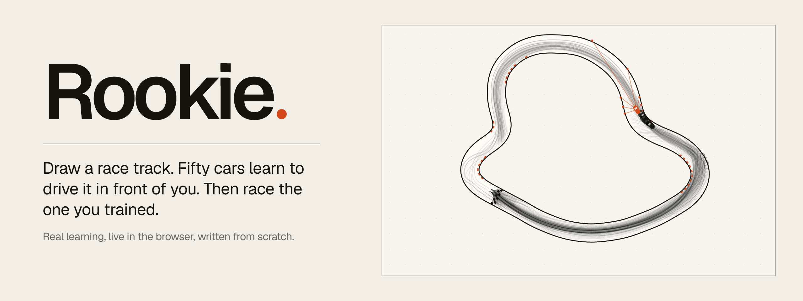
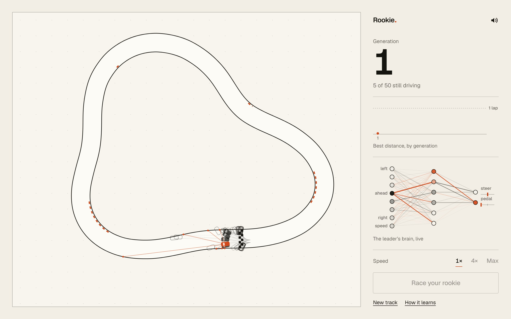
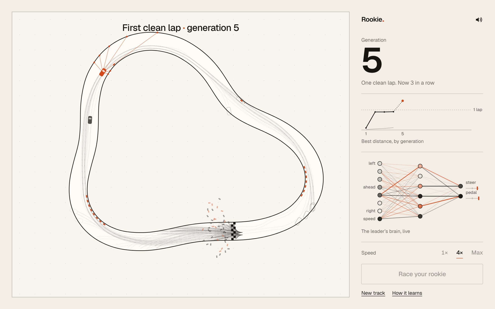
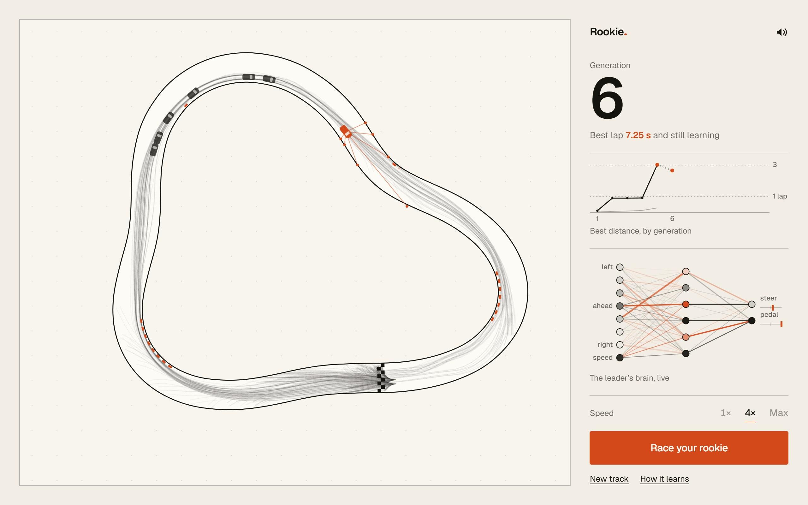
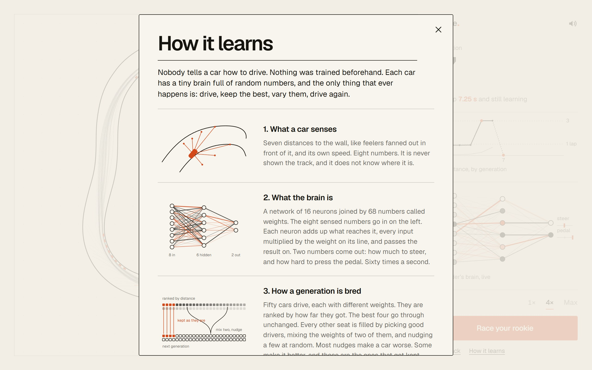
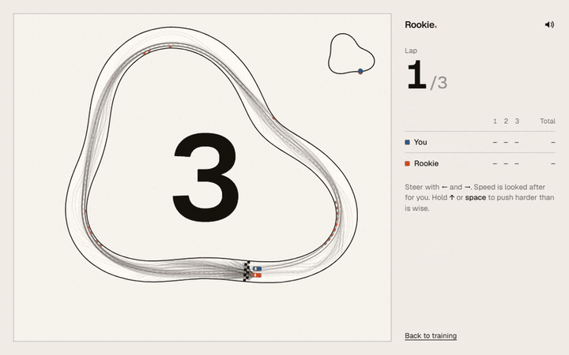
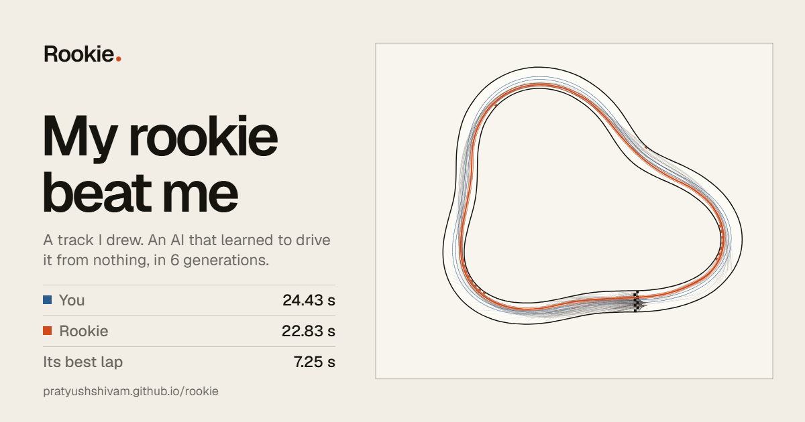
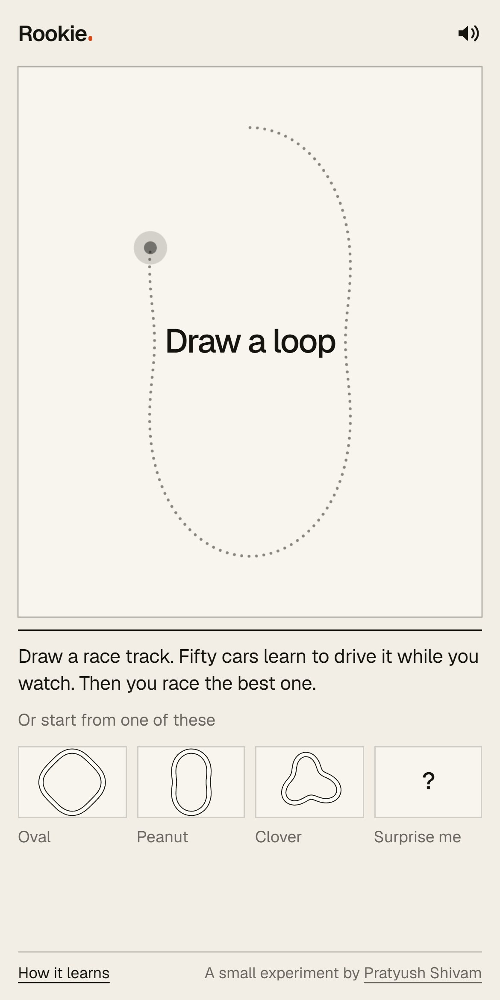
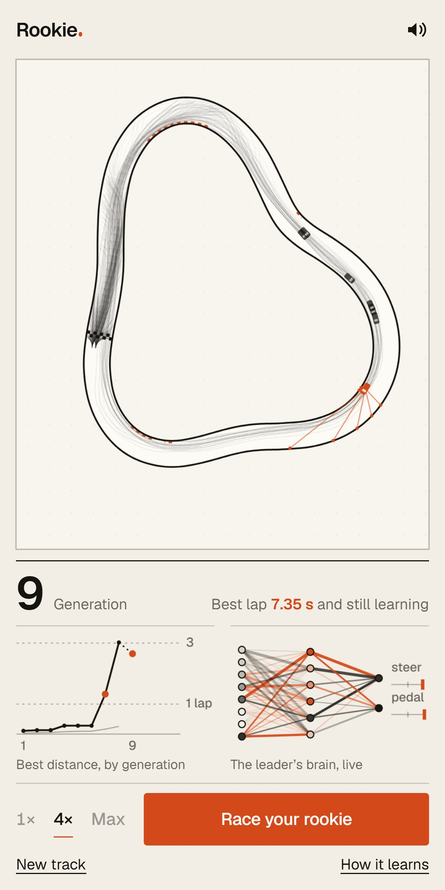
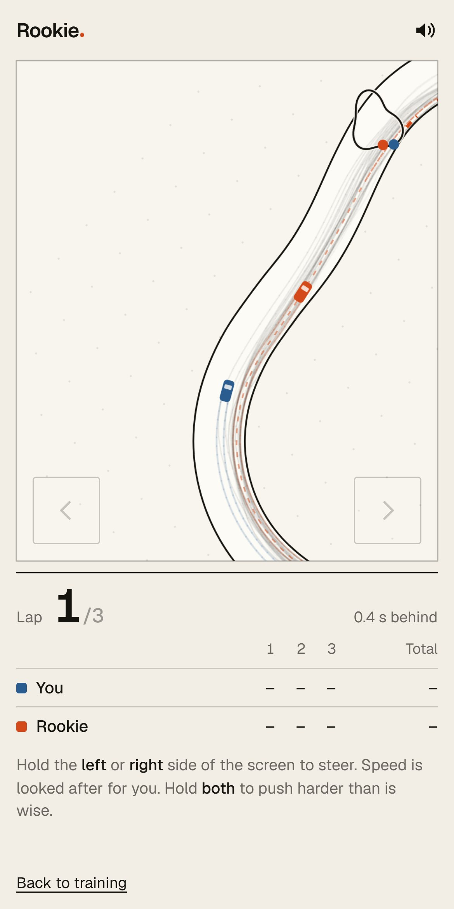

<a href="https://pratyushshivam.github.io/rookie/"></a>

<p align="center">
  <a href="https://pratyushshivam.github.io/rookie/"></a>
  <a href="https://github.com/pratyushshivam/rookie/actions/workflows/ci.yml"></a>
  <a href="LICENSE"></a>
  
</p>

<p align="center">
  <a href="https://pratyushshivam.github.io/rookie/"><b>Try it</b></a> ·
  <a href="#how-it-goes">How it goes</a> ·
  <a href="#how-it-learns">How it learns</a> ·
  <a href="#the-numbers">The numbers</a> ·
  <a href="#run-it">Run it</a> ·
  <a href="https://www.pratyushshivam.com/projects/rookie/">The full write-up</a> ·
  <a href="https://www.pratyushshivam.com/">pratyushshivam.com</a>
</p>

# Rookie

**Draw a race track. Watch fifty cars learn to drive it. Then race the one you trained.**

You drag a loop with a finger or a mouse and it becomes a road. Fifty cars line up on it, each with a small brain full of random numbers, and drive straight into the walls. The ones that got furthest are kept, the rest are bred from them, and they go again. A few generations later one of them laps the track cleanly, in front of you, on a track nobody has ever seen before.

Then you get a car of your own and three laps against it.

**Try it:** [pratyushshivam.github.io/rookie](https://pratyushshivam.github.io/rookie/)

<a href="https://pratyushshivam.github.io/rookie/"></a>

<p align="center"><sub>One whole run, recorded from the running page at real speed: thirty seconds from an empty sheet to a car that can lap it. Nothing is replayed. The learning happens while you watch.</sub></p>

There is nothing to read first. The sheet says *draw a loop* and a ghost finger shows how. There is no account, no server, no model download and no tracking. The network, the physics and the learning are written from scratch, with no libraries, and the whole page is about 58 kB.

<table>
<tr>
<td width="50%" valign="top"><br><sub><b>Generation 1.</b> Random brains. A pile-up. The orange car is whoever is furthest along; the lines are what it senses.</sub></td>
<td width="50%" valign="top"><br><sub><b>The first clean lap.</b> Four generations of crashing, then this. The marks on the road are every car that has driven it.</sub></td>
</tr>
<tr>
<td width="50%" valign="top"><br><sub><b>Ready.</b> Nobody drew that racing line. It is where the surviving cars happened to drive, again and again.</sub></td>
<td width="50%" valign="top"><br><sub><b>How it learns</b>, on the page itself, in plain words and three pictures.</sub></td>
</tr>
</table>

## How it goes

| | |
| :-- | :-- |
| **Draw** | Drag one loop on the sheet. It is smoothed, closed, given a road, kerbs and a start line. The cars drive the way you drew it |
| **Bad drawings** | Too small is grown. An overshoot is trimmed. A figure of eight keeps its bigger loop. Corners too sharp for a road are opened up. If it still cannot be a track, the sheet shows where the trouble is and you draw again |
| **Or don't draw** | Three ready-made tracks and a *surprise me* |
| **Learn** | Fifty cars per generation. A counter, a chart of best distance, and the leader's network drawn live. `1×`, `4×` or `Max` speed |
| **Race** | Three laps against your rookie. The camera rides behind your car |
| **Controls** | Hold the left or right half of the screen, or `←` `→`. Your speed is looked after for you. Hold both halves, or `↑`, to go faster than is wise. `M` mutes |
| **Hitting a wall** | In training the car is out. In the race you are put back on the road and lose a second. So is the rookie |
| **Share** | A link that carries the track and the trained driver, a line of text, and a picture |

<a href="https://pratyushshivam.github.io/rookie/"></a>

<p align="center"><sub>The race, recorded from the page. The dotted line is the rookie's own line from training. The blue car here is steered by a simple script standing in for a person.</sub></p>

<table>
<tr>
<td width="62%" valign="top"></td>
<td width="38%" valign="top">

**The link holds everything.** The track is about a hundred whole-number control points and the driver is 68 numbers, so both fit after the `#` of a link, which browsers never send to a server. Whoever opens it gets the same road and the same driver, bit for bit, and can race it or train their own on your track.

**The picture** is drawn on a canvas in your browser. Nothing is uploaded.

</td>
</tr>
</table>

## On a phone

<table>
<tr>
<td width="33%" valign="top"></td>
<td width="33%" valign="top"></td>
<td width="33%" valign="top"></td>
</tr>
</table>

<p align="center"><sub>The sheet takes the shape of the screen. Captured at phone size in desktop Chrome, from a real run.</sub></p>

## How it learns

The method is called **neuroevolution**: a genetic algorithm over the weights of a small neural network. There is no gradient, no reward signal during a drive, no training data and nothing learned beforehand. It was chosen because it is honest and visible. Every car you see is a different network, and the only thing that separates a good one from a bad one is how far it got.

**What a car senses.** Seven distances to the wall, measured along lines fanned out in front of it from 75° left to 75° right, each capped at 300 units, and its own speed. Eight numbers between 0 and 1. It is never given the track, its position or the way round.

**What the brain is.** A feed-forward network: 8 inputs, 6 hidden neurons, 2 outputs, joined by 68 weights. Each neuron adds up its inputs, each multiplied by a weight, adds a bias, and squashes the total with `tanh`. The two outputs are the steering, from full left to full right, and the pedal, from brake to full throttle. It runs sixty times a second.

**What the score is.** The furthest point along the road the car has reached. Only forward progress counts, so reversing over the line scores nothing. A car is out when it touches a wall, gains no ground for 1.6 seconds (spinning on the spot), goes back past the grid, or falls behind a sweeper travelling at 120 units a second (crawling). A generation ends when everyone is out or one car has finished three laps, so among cars that finish, the quickest wins.

**How a generation is bred.**

1. Rank the fifty by score.
2. The best four go through unchanged. The same car on the same track always drives the same, so the best can never get worse.
3. Every other seat: pick three at random from the better half and take the best of them. Half the time pick a second parent the same way and take each weight from one or the other.
4. Nudge about a fifth of the child's weights by a small random amount. Most children get a normal nudge, a fifth get a gentle one, one in eight a wild one.
5. If the best score has not moved, the nudges grow by 30% per stuck generation, and after three stuck generations six complete newcomers join. Once a car has finished all three laps the nudges shrink, to polish the lap time.

**Why it works so fast.** The problem is small on purpose. Eight inputs, 68 weights, and a score that rises smoothly as a car gets a little further round. A random network that merely turns away from the nearer wall already survives the first bend, and from there every improvement is a small step.

```
src/engine   everything that thinks: seeded random numbers, tracks from a stroke, the wall
             grid and ray casts, car physics, the network, breeding, the learning loop,
             the race, the link format. No page, no clock, no Math.random. Tested.
src/game     the canvas stage, the chart and the brain view, sound, sharing, storage
src/main.ts  the page: pointer input, the frame loop, the words
tests        45 tests over the engine and the share text
scripts      banner.html (this page's banner, from a real training run), and two benches
```

### The engineering

**From a stroke to a road.** The stroke is resampled evenly and lightly smoothed. An end that runs on past the start is cut where it comes closest. If the closed line crosses itself it is two loops joined at the crossing, and the longer one is kept, repeatedly, until one simple loop is left. A small loop is scaled up. Then a relaxation pass runs: wherever the radius is under 42 units the corner is eased open, wherever two stretches come within 82 units of each other they are pushed apart, a little at a time, until neither happens. The result is reduced to control points 28 units apart, rounded to whole numbers, and the road is a closed cubic B-spline through them, sampled every 6 units. The start line goes at the beginning of the straightest stretch.

**Rays are cast through a grid.** The two edges of the road are about 800 wall segments. They are sorted into a uniform grid of 48-unit cells, and each sensor ray walks the grid cell by cell, testing only the walls in the cells it passes and stopping at the first hit. A test checks that this gives exactly the same answer as testing every wall.

**The car slides.** The body turns where the wheels point. The tyres can remove sideways speed only so fast (640 units/s²), so a car that turns in too quickly keeps moving the way it was going, scrubs speed, and usually meets the outside wall. Steering moves at a limited rate. The brake slows the car to a crawl and never to a stop, like an automatic gearbox, which is why generation 1 is a pile-up and not a car park.

**Everything is deterministic.** The engine advances in fixed steps of 1/60 s and takes every random number from one seeded generator. The same seed gives the same evolution, weight for weight, which is tested, and is what lets a shared rookie drive the same race for whoever opens the link.

**The stage is one canvas.** The road is three cached paths. Tyre marks are drawn once onto their own layer and never redrawn, so the racing line costs nothing to keep. At `Max` the page runs as many simulation steps as fit in nine milliseconds and then draws a frame, so it never freezes. Sound is made on the spot with WebAudio: an engine note that follows the leader's speed, a tick per generation, a chord for the first clean lap.

## The numbers

| | |
| :-- | :-- |
| Field | 50 cars per generation, 68 weights each |
| Unseen tracks | 200 random drawings, one run each: all 200 reached a clean lap within 40 generations. Median generation 6, nine in ten by generation 12, slowest 21 |
| Three laps in a row | Median generation 6, nine in ten by generation 13 |
| Time to the first clean lap | 47 seconds of driving on average. At the page's default speed, usually 20 to 40 seconds on the clock |
| Simulation speed | One step for all 50 cars takes about 0.03 ms on a laptop: around 600 times faster than real time |
| Frame rate | 60 frames a second at phone size with the processor throttled to a quarter speed, at every speed setting |
| The race | A script that steers down the middle of the road finishes within about a tenth of a freshly trained rookie, sometimes ahead and sometimes behind. Train longer and the rookie pulls away |
| A link | About 750 characters for a track and its driver |
| Size | About 58 kB of script, style, markup and typeface, compressed. No dependencies at run time |

Reproduce the first three rows with `npx tsx scripts/bench.ts 200 40`.

## What is simplified

- **It is a toy car.** One rigid body, a grip limit and a slide. No weight transfer, no gears, no tyres that wear.
- **Cars pass through each other.** In training that is what lets fifty share a road. In the race it means there is no blocking.
- **The rookie only knows this track.** It has learned one road by trial and error. On a different track it would have to learn again, though usually more quickly than from nothing.
- **Your speed is managed.** In the race a careful speed is held for you so that a child can play with two fingers. The rookie gets no such help: it works its own pedal.
- **Evolution is not how large networks are trained.** It works here because the network is tiny. For millions of weights you need gradients. The idea it shows is real, though: nobody programmed the driving, only the scoring.

## Run it

Needs Node.js 20 or newer.

```bash
npm install
```

```bash
npm run dev
```

Then open `http://localhost:5240`. Add `?seed=7` to make a training run repeatable, `?speed=4` or `?speed=0` (Max) to start faster, and `?auto` to let a simple script steer your car in the race.

| Command | What it does |
| :-- | :-- |
| `npm run dev` | Development server |
| `npm run build` | Type check, then a static build in `dist/`, ready for any static host |
| `npm test` | The tests for the engine and the share text |
| `npm run preview` | Serve the built page on port 5241 |
| `npx tsx scripts/bench.ts` | Train on random drawings and report how many generations each took |
| `npx tsx scripts/racebench.ts` | Train, then race a scripted driver against each rookie |

The build uses relative paths, so the same `dist/` works at a domain root or in a sub-folder. It makes no network calls. The only things kept in your browser are your best laps and the mute setting.

Every picture and recording on this page was captured from the running page in Chrome. The banner was drawn by `scripts/banner.html`, which runs a real training session with the page's own engine and renderer and stops it part of the way through a generation.

## Licence

[MIT](LICENSE). The typeface is [Geist](https://github.com/vercel/geist-font), under the SIL Open Font License.

<p align="center"><sub>Built by <a href="https://www.pratyushshivam.com/">Pratyush Shivam</a>.</sub></p>
